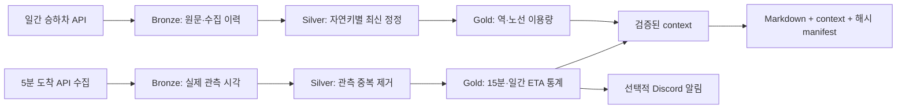

# Seoul Subway Daily Reporting

서울 지하철 공공 API에서 **지연되어 제공되는 승하차 데이터와 주기적으로 관측한 도착 ETA를 수집하고, 재실행 가능한 분석 테이블과 근거가 남는 일간 리포트를 만든다.**

이 프로젝트의 중심 문제는 서로 다른 시간 기준과 원천의 제약을 가진 데이터를 정확하게 처리하는 것이다. 승하차 데이터는 보고서 생산일 D-4, 도착 관측은 D-1을 사용한다. 도착 API를 5분마다 호출하는 구조이며 연속 이벤트 스트림은 아니다. ETA를 실제 승객 대기시간이나 시간표 대비 지연으로 해석하지 않는다.

## 설계



Airflow가 실행 날짜와 의존성을 관리하고 Spark/Delta Lake가 저장·변환을 담당한다. S3 저장을 지원하며, 로컬 파일 시스템에서도 같은 변환을 검증한다. Kafka는 현재 알림 전달만을 위한 추가 운영 비용이므로 제거했다. 선택 근거는 [ADR](docs/adr/001-batch-first.md)에 남겼다.

| 계층 | 책임 | 재실행 정책 |
|---|---|---|
| Bronze Delta | 원문, record hash, run ID, 수집 시각 보존 | append; 재수집 이력 보존 |
| Silver Delta | 타입·키 검증, 최신 정정 및 관측 중복 처리 | 해당 날짜/시간 파티션 교체 |
| Gold Delta | 이용량, 유효 ETA 표본 기반 집계 | 날짜/15분 window 교체 |
| Report | 수치·기준일·입력 Delta 버전 기록 | 같은 입력은 같은 템플릿 결과, manifest 해시 검증 |

v2는 기존 저장 경로와 분리했다. 이전 데이터는 자동 수정하지 않는다. 여러 테이블을 묶는 트랜잭션은 없으며, Delta의 원자적 커밋은 테이블별로 적용된다.

## 개선과 검증 근거

| 문제 | 개선 | 재현 증거 |
|---|---|---|
| 같은 날짜를 재수집하면 합계가 증가 | 날짜·노선·역 자연키별 최신 정정 선택 | 3행을 두 번 저장해도 Silver 3행·합계 660 유지 |
| 원천 정정이 집계에 반영되어야 함 | REG_YMD·수집 시각으로 최신 버전 선택 | 정정 후 660 → 680, 다른 날짜 합계 보존 |
| 자정·월말을 넘는 window 누락 | KST 반개구간과 필요한 시간 파티션 계산 | 1월 31일~2월 1일 관측 6건·유효 ETA 5건 |
| 결측 ETA가 0초로 계산 | NULL 보존, 전체 관측과 유효 표본 분리 | 평균·비율의 유효 표본 분모 확인 |
| 역명 조인으로 환승역 수치가 중복 | 출처별 요약 분리, 도착 역·노선 ID 유지 | 환승역의 서로 다른 노선 결과 보존 |
| 처리 중단 시 Silver/Gold의 결과 불일치 | 원본 재처리·품질 gate | Silver 커밋 후 중단 → 기존 Gold 유지 → 정정 값 680 복구 |
| 알림 소비자에 불필요한 Kafka 의존 | Airflow 직접 연결·선택적 webhook | 알림 실패와 보고서 트리거의 의존성 분리 |

위 수치는 **합성 fixture의 회귀 실험 결과**이며 서울 실제 이용량이나 처리량 벤치마크가 아니다. [샘플 리포트](examples/subway_report_20260201.md), [실험 기록](examples/evidence.json), [검증 코드](tests/test_pipeline_spark.py)를 함께 확인할 수 있다.

## 키 없이 실행

Python 3.11, Java 11/17과 Spark 의존성 다운로드를 위한 최초 네트워크 접근이 필요하다. API·AWS·OpenAI·Discord 키는 필요하지 않다.

```bash
python3.11 -m venv .venv
source .venv/bin/activate
pip install -r requirements/dev.txt
python scripts/demo.py --output-dir .work/demo/my-run
python scripts/verify_report.py .work/demo/my-run/reports/subway_report_20260201.md
pytest -q --ignore=tests/test_dags.py
ruff check src dags scripts tests
```

데모는 비어 있는 출력 디렉터리만 허용한다. 최초 실행 시 Maven에서 Delta JAR을 받지만 데이터 입력은 저장된 fixture만 사용한다.

## 품질 감사와 복구 실험

기술 구성에서 끝내지 않고 실패·복구·결과 검증을 재현한다. 실제 로컬 Delta 커밋 후 예외를 주입해 기존 Gold 보존, 원본 재처리, 잘못된 원천 값 차단을 확인한다.

```bash
python scripts/recovery_experiment.py --output-dir .work/recovery/my-run
```

[복구 실험 결과](examples/operations/recovery.md)에는 단계별 합계·Delta 버전과 측정 범위를, [품질 감사 결과](examples/operations/quality.md)에는 누락 시간 구간·ETA 표본·원본/처리 차이·파일 수를 남겼다. 모두 합성 데이터의 실제 로컬 실행 결과다. Airflow 태스크 callback은 실행·재시도·대기 로그를 남기며, 운영 측정은 별도로 필요하다. 명령과 지표의 정확한 의미는 [관측·복구 문서](docs/OBSERVABILITY.md)에서 확인한다.

## 실제 Airflow 태스크 연결 검증

DAG 구조 검사에 더해 저장된 합성 Bronze에서 `usage_daily → gold_daily → report_daily`를 실제 태스크로 실행했다. API 재수집 분기는 skipped, Spark 변환·날짜 XCom·두 DAG 트리거·보고서 생성은 실제 코드로 처리했다. **태스크 12개 성공과 보고서 해시 검증**을 확인했고, 실제 실행 시간과 미측정 queue를 구분해 [실행 증거](examples/airflow/evidence.md)에 남겼다.

[재현 명령](docs/AIRFLOW_OFFLINE.md)은 별도 SQLite DB와 두 가상환경을 사용한다. 로컬 순차 실행이며 실수집·scheduler·분산 executor·S3 운영 검증은 추가로 필요하다.

## 자동화

- `arrival_collect_5m`: 실제 수집 시각으로 원문 저장.
- `pipeline_arrival_5m`: 실행 구간 끝을 기준으로 저장된 Bronze 처리 → 15분 Gold → 선택적 ETA 알림.
- `usage_daily`: 매일 06:00 KST에 D-4 수집 → Silver → Gold → 일간 도착 처리 트리거. `reprocess_only`로 API 없이 재처리 가능.
- `gold_daily`: D-1 원본 재처리 → 일간 도착 Gold → 알림과 보고서 각각 실행.
- `report_daily`: 날짜와 데이터 품질 확인 → 기본 템플릿 보고서 생성. LLM 해설은 선택 기능.

Docker Compose와 Kubernetes 설정을 제공한다. 이번 변경에서 실제로 검증한 범위는 로컬 Spark/Delta 처리, 실제 Airflow DagBag·템플릿 검사, Compose 설정 파싱이다. 컨테이너 빌드·Kubernetes 배포·S3 운영·실제 API의 지속 수집은 별도 검증 대상이다. GitHub Actions는 파이프라인·DAG 검증, 합성 데모·복구 실험, 실제 로컬 Airflow 연결 실행을 별도 job으로 정의했다.

## 문서와 남은 작업

[데이터 계약](docs/DATA_CONTRACTS.md), [실행·복구 runbook](docs/RUNBOOK.md), [프로젝트 맥락](docs/PROJECT_CONTEXT.md), [로드맵](docs/ROADMAP.md), [검증 범위](docs/VALIDATION.md), [작업 인수인계](docs/SESSION_HANDOFF.md)를 관리한다. [AGENTS.md](AGENTS.md)와 저장소의 [커밋 스킬](.agents/skills/write-commit/SKILL.md)은 이후 작업에서도 같은 기준을 유지한다.

다음 평가는 실제 수집 기간의 누락·신선도·응답 상한 도달 빈도, 실패 후 복구 시간, 파일 수·크기에 근거해야 한다. 작은 합성 데이터 실험으로 대규모 처리 성능이나 전체 서울 지하철 커버리지를 주장하지 않는다. Databricks notebook은 이전 학습 기록이며 v2 운영 코드의 검증 근거로 사용하지 않는다.
