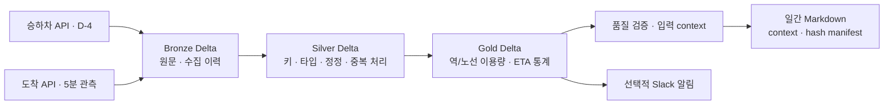

# Seoul Subway Daily Reporting


> 서울 지하철 공공 API를 수집하고, 재처리 가능한 분석 테이블과 데이터 근거가 남는 일간 리포트를 만드는 End-to-End 데이터 플랫폼.

---

## Project Overview

서울 열린데이터의 **승하차 인원과 도착 ETA**를 수집 → 정제 → 집계 → 리포트 생성까지 연결합니다. 서로 다른 제공 시점과 제한된 도착 응답을 가진 원천에서 **재수집·정정·시간 경계·처리 실패에도 같은 입력의 결과가 유지되는 구조**를 만드는 것이 핵심입니다.

- **Spark + Delta Lake**: Bronze / Silver / Gold 계층과 자연키 기반 정정 처리
- **Apache Airflow**: 수집·처리·일간 보고서의 실행 구간과 의존성 관리
- **KubernetesExecutor**: 태스크별 worker Pod, 자원 프로필, 재시도와 PVC 로그 보존
- **Databricks Free Edition**: 공통 변환의 managed Delta 처리, 품질 차단, time travel, SQL 제공 검증
- **Data Quality & Recovery**: 잘못된 입력 출판 차단, 원본 재처리, 전체 행 해시로 결과 확인
- **Daily Reporting**: 기준일·관측 범위·입력 Delta 버전과 해시를 담은 Markdown 보고서

보고서의 승하차는 생산일 **D-4 이용 날짜**, 도착은 **D-1 관측 날짜**입니다. 도착 API의 주기적 배치 관측이며, ETA는 실제 운행 지연이나 승객 대기시간을 뜻하지 않습니다.

[코드 구조](docs/REPOSITORY_GUIDE.md) · [샘플과 테스트 결과](examples/README.md) · [샘플 리포트](examples/subway_report_20260201.md)

---

## System Architecture



Airflow가 실행 날짜와 의존성을 관리하고, KubernetesExecutor가 처리 태스크를 Pod로 실행합니다. Spark/Delta 변환은 로컬 파일 시스템과 S3 저장 경로를 지원합니다. **실제 S3 운영은 아직 검증하지 않았습니다.**

Databricks는 공통 승하차 변환을 **Unity Catalog managed Delta와 SQL view로 제공하는 별도 실행 경로**입니다. Free Edition에서 실제 Job과 SQL warehouse를 실행했으며, AWS와 Databricks를 자동 연계하는 구성은 현재 포함하지 않습니다. [플랫폼 선택 근거](docs/adr/002-execution-platforms.md)

---

## Data Layer Design (Bronze / Silver / Gold)

| Layer | 역할 | 재실행 정책 |
|---|---|---|
| **Bronze** | 원문, record hash, run ID, KST 수집 시각 보존 | append로 재수집 이력 보존 |
| **Silver** | 키·타입 검증, 최신 정정 선택, 관측 중복 처리, 결측 ETA 보존 | 대상 날짜·시간 파티션 교체 |
| **Gold** | 역/노선 이용량, 15분·일간 ETA 통계와 유효 표본 수 | 대상 날짜·window 교체 |
| **Report** | 기준일·관측 범위·입력 버전·출판 해시 | 같은 입력의 템플릿 결과 재현 |

원천 생성 시각, 수집 시각, 이용 날짜, 처리 구간을 구분합니다. Delta는 테이블 루트와 transaction log로 읽으며 테이블별 커밋을 사용합니다. 여러 테이블에 걸친 처리는 품질 검증과 재처리로 일관성을 확인합니다. [데이터 계약](docs/DATA_CONTRACTS.md)

---

## Data Pipelines

### 1. Ingestion (Bronze)

- 승하차는 이용 날짜를 지정하고 페이지별 건수와 수집 내부 자연키를 검사해 반복·누락 페이지를 차단합니다.
- 도착은 실제 수집 시각을 가진 snapshot을 저장합니다. 과거 미수집 실시간 관측은 복원할 수 없습니다.
- 원문과 수집 이력을 보존하고, API 재수집과 저장 원본 재처리를 구분합니다.

### 2. Processing (Silver / Gold)

- 같은 날짜를 다시 수집해도 자연키 기준 최신 정정만 선택해 합계가 중복 증가하지 않습니다.
- 잘못된 키·날짜·수치와 빈 입력은 정상 결과로 출판하지 않습니다.
- KST 자정·월말을 넘는 구간을 처리하고, 전체 관측 수와 유효 ETA 표본 수를 별도로 집계합니다.

### 3. Orchestration

| DAG | 책임 |
|---|---|
| arrival_collect_5m | 도착 원본 수집 |
| pipeline_arrival_5m | 저장된 도착 원본 → Silver → 15분 Gold → 선택적 ETA 알림 |
| usage_daily | 매일 06:00 KST D-4 승하차 수집·처리, API 없이 재처리 가능 |
| gold_daily | D-1 도착 원본 재처리·일간 집계, 보고서와 알림 각각 연결 |
| report_daily | 날짜·품질 확인 → context·보고서·manifest 생성 |

S3 Delta writer는 **ssdr_delta_writer 1-slot pool**로 직렬화합니다. 알림 실패가 보고서 생성을 막지 않도록 의존성을 분리했습니다. 현재 운영 경로에는 Kafka가 필요하지 않아 제거했습니다. [Batch-first 설계](docs/adr/001-batch-first.md)

---

## Reporting & Alerting

기본 보고서는 검증된 Gold context에서 **결정적인 템플릿**으로 생성합니다. 수치뿐 아니라 이용 날짜, 실제 관측 범위, 입력 Delta 버전과 SHA-256을 함께 남겨 결과를 추적합니다. 본문·context·manifest를 담은 단일 발행 객체를 마지막에 교체해 중간 쓰기 실패에도 이전 보고서를 읽도록 했습니다. [발행 중단·복구 검증](examples/operations/publication-commit.md)

LLM 해설과 Slack 전송은 선택 기능입니다.

15분 ETA 알림은 유효 표본 수·긴 ETA 비율·분위수를 확인합니다. 이를 시간표 대비 운행 지연이나 현재 혼잡도로 단정하지 않습니다. [샘플 보고서와 입력 근거](examples/README.md)

---

## Databricks (Free Edition)

공통 승하차 변환을 Free Edition의 serverless Job으로 실행하고, Unity Catalog의 managed Delta 테이블과 SQL view로 제공했습니다. 합성 승하차 데이터로 정정·재처리를 시험하고 로컬 결과와 비교했습니다.

| 기능 | 확인한 내용 |
|---|---|
| Serverless Job | 네 태스크 SUCCESS, 정정 값 반영·인접 날짜 보존·재처리 해시 일치 |
| Quality Gate | 불량 최신 정정의 Silver 출판 차단, 기존 출판 버전 보존 |
| Delta History / Time Travel | 정상 정정 680→700과 과거 버전 680 확인 |
| Unity Catalog SQL View | 품질 PASS 날짜만 제공하는 분석 view와 COMMENT |
| SQL Warehouse | 날짜별 이용량·역/노선 순위·품질·Catalog 네 쿼리 성공 |

[Job 실행 결과](examples/databricks/README.md) · [품질·SQL 실행 결과](examples/databricks/free-edition.md) · [기능 선택과 재현](docs/DATABRICKS_FREE.md)

---

## Kubernetes Deployment

Docker Desktop의 로컬 Kubernetes 클러스터에서 **scheduler → worker Pod → 보고서**를 실행했습니다.

| 구성 요소 | 사용 방식 |
|---|---|
| Airflow | 고정 Helm chart와 KubernetesExecutor |
| Worker | control / spark / report 자원 프로필 |
| Storage | lake/log PVC, 태스크 Pod 종료 후 로그 보존 |
| Isolation | namespace RBAC, fixture와 외부 서비스 Secret 분리 |
| Write Control | Delta writer pool 1 slot |

태스크 12개 성공, 실행 중 Gold worker 삭제 후 **새 Pod 재시도 성공**, 삭제된 worker 로그 13개 보존을 확인했습니다. 동일 Bronze 재처리의 **7개 Delta 테이블 전체 행 해시와 원본 버전**도 유지됐습니다.

worker 메모리 peak와 CPU 제한을 관측해 control 예약 메모리를 **256→512MiB**, CPU 상한을 **0.5→1코어**로 조정했습니다. 단일 node·합성 입력이며 Spark는 Pod 내부 local[2]입니다.

[실행·복구 결과](examples/kubernetes/README.md) · [자원 측정](examples/kubernetes/resources.md) · [배포 절차](docs/KUBERNETES.md)

---

## Validation & Results

| 테스트 | 결과 |
|---|---|
| 재수집·정정 | 합성 3행 재수집에도 합계 660 유지, 정정 후 680·인접 날짜 보존 — [기본 실험](examples/evidence.json) |
| 시간·결측·identity | KST 자정/월말·UTC 호스트, NULL ETA·환승역 구분 — [회귀 테스트](tests/test_pipeline_spark.py) |
| 실패 복구 | Silver 커밋 후 중단 → 기존 Gold 보존 → 원본 재처리 복구 — [복구 실험](examples/operations/recovery.md) |
| 저장 파일 유지보수 | 합성 36,000행의 닫힌 시간 파일 24→1, 전체 행·인접 파일·재처리 결과 보존 — [compaction](examples/operations/compaction.md) |
| 실제 원천 | 도착 3회·3,000행, D-4 승하차 617행. 도착 응답 3회 모두 1,000건 상한, 7개 테이블 재처리 일치 — [수집 결과](examples/observed/evidence.md) |
| 날짜별 관측 비교 | 실패·일정 놓침·기록 누락·미확인 날짜를 분리하고 성공률 분모 명시 — [관측 절차](docs/SOURCE_OBSERVATION.md) |
| GitHub Actions | 파이프라인·DAG/Pod 구성·Airflow 연결·컨테이너 실행 네 검사 — [CI](https://github.com/HongJunseong/seoul-subway-daily-reporting/actions) |

Databricks·Kubernetes 실험에는 합성 데이터를 사용했습니다. 서울 API 수집 결과는 아래의 관측 범위 안에서 해석해야 합니다.

---

## Limitations & Future Work

- **API 응답 범위**: 도착 응답 1,000건 상한은 전체 역·열차 확보를 보장하지 않습니다.
- **날짜와 지표 의미**: D-4 이용량은 해당 날짜의 값이며 ETA는 실제 운행 지연이 아닙니다.
- **관측 기간**: 현재 서울 API 수집 결과는 1일·10분 규모입니다. 장기 결측률과 수집 신선도는 추가 관측이 필요합니다.
- **운영 비용**: S3 실제 운영·비용, 더 큰 입력의 자원·pool 대기, 유지보수 중인 플랫폼 조합을 추가 검증해야 합니다.

남은 작업은 [로드맵](docs/ROADMAP.md), 테스트 환경과 범위는 [검증 문서](docs/VALIDATION.md)에 정리했습니다.

---

## Execution Flow

### 키 없이 실행

Python 3.11, Java 11/17과 최초 Spark/Delta 의존성 다운로드가 필요합니다. API·AWS·Slack·LLM 키는 사용하지 않습니다.

```bash
python3.11 -m venv .venv
source .venv/bin/activate
pip install -r requirements/dev.txt
python scripts/demo.py --output-dir .work/demo/my-run
python scripts/verify_report.py .work/demo/my-run/reports/subway_report_20260201.publication.json
pytest -q --ignore=tests/test_dags.py --ignore=tests/test_kubernetes_profiles.py
ruff check src dags scripts tests
```

새 출력 디렉터리에서 합성 원본의 수집 이력·변환·품질·보고서를 재현합니다.

### 플랫폼별 실행

- [Kubernetes 실행](docs/KUBERNETES.md): Docker 이미지·Helm·Pod/PVC·writer pool 설정
- [Databricks 실행](databricks/README.md): 공식 CLI 인증·bundle·managed Delta Job
- [원천 제한 수집](docs/SOURCE_OBSERVATION.md): 외부 API opt-in, private 원문과 로컬 재처리
- [복구 실험](docs/OBSERVABILITY.md): 저장 원본에서 품질 차단·부분 커밋 복구

### 코드와 운영 문서

[코드 구조](docs/REPOSITORY_GUIDE.md) · [실행·복구 방법](docs/RUNBOOK.md) · [데이터 계약](docs/DATA_CONTRACTS.md)

서울 API 원문·정제 행·.env·인증 파일은 로컬에 보관합니다. 공개 저장소에는 합성 샘플과 수집 결과 요약을 포함합니다.
