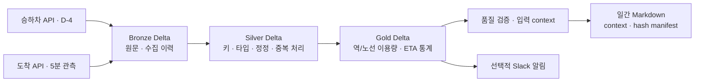

# Seoul Subway Daily Reporting


> 서울 지하철 공공 API를 수집·정제하고, 검증된 집계를 프롬프트에 전달해 LLM 일간 보고서를 생성·저장하는 데이터 파이프라인.

---

## Project Overview

서울 열린데이터의 **승하차 인원과 도착 ETA**를 수집 → 정제 → 집계 → LLM 보고서 생성까지 연결합니다. 제공 시점이 다른 두 원천을 다루면서, 중복 수집·정정·처리 실패에도 분석 결과를 일관되게 유지하는 데 집중했습니다.

- **Spark + Delta Lake**: Bronze / Silver / Gold 계층과 최신 정정 처리
- **Apache Airflow**: 수집·처리·보고서의 일정과 의존성 관리
- **KubernetesExecutor**: 태스크별 Pod 실행, 자원 설정과 실패 후 재시도
- **Databricks Free Edition**: 공통 변환을 managed Delta와 SQL view로 제공

보고서는 생산일 기준 **D-4 승하차 이용량**과 **D-1 도착 관측**을 각각 표시합니다. ETA는 관측 당시의 도착 예정 정보이며, 실제 운행 지연이나 승객 대기시간으로 해석하지 않습니다.

[샘플 리포트](examples/subway_report_20260201.md) · [코드 구조](docs/REPOSITORY_GUIDE.md) · [테스트 결과](examples/README.md)

---

## System Architecture



Airflow가 실행 구간을 관리하고 KubernetesExecutor가 처리 태스크를 Pod로 실행합니다. Spark/Delta는 로컬·S3 저장 경로를 지원하며, Databricks는 같은 승하차 변환의 관리형 처리·SQL 제공 경로입니다. [플랫폼 선택](docs/adr/002-execution-platforms.md)

---

## Data Layer Design (Bronze / Silver / Gold)

| Layer | 역할 | 재실행 정책 |
|---|---|---|
| **Bronze** | 원문과 수집 이력 보관 | append로 이력 보존 |
| **Silver** | 키·타입 검증, 최신 정정과 중복 처리 | 대상 날짜·시간 파티션 교체 |
| **Gold** | 역/노선 이용량, 15분·일간 ETA 집계 | 대상 날짜·구간 교체 |
| **Report** | 기준일과 입력 버전을 담은 보고서 | 같은 입력의 템플릿 결과 재현 |

이용 날짜·원천 시각·수집 시각·처리 구간을 구분하며 Delta 테이블 루트로 읽고 씁니다. [데이터 계약](docs/DATA_CONTRACTS.md)

---

## Data Pipelines

### 1. Ingestion (Bronze)

- 승하차는 이용 날짜를 지정하고 페이지 누락·반복을 검사합니다.
- 도착은 5분마다 관측합니다. 원문을 보관해 처리 실패 후 재사용하며, 과거 미수집 관측은 복원할 수 없습니다.

### 2. Processing (Silver / Gold)

- 자연키 기준으로 최신 정정을 반영해 재수집으로 합계가 늘어나는 문제를 막습니다.
- 잘못된 입력을 차단하고, KST 자정·월말과 결측 ETA를 고려해 집계합니다.

### 3. Orchestration

| DAG | 책임 |
|---|---|
| arrival_collect_5m | 도착 원본 수집 |
| pipeline_arrival_5m | 저장 원본 → Silver → 15분 Gold → 선택적 ETA 알림 |
| usage_daily | 매일 06:00 KST D-4 승하차 수집·처리 |
| gold_daily | D-1 도착 재처리·일간 집계, 보고서와 알림 연결 |
| report_daily | 품질 확인과 일간 보고서 생성 |

Delta 쓰기 작업은 직렬 실행하고, 알림 실패가 보고서 생성을 막지 않도록 의존성을 분리했습니다. [배치 처리 설계](docs/adr/001-batch-first.md)

---

## Reporting & Alerting

검증된 Gold에서 Markdown 보고서를 만들고 기준일·관측 범위·입력 버전을 함께 기록합니다. 발행 중 쓰기가 중단되면 이전 보고서를 읽을 수 있도록 구성했습니다.

LLM은 검증된 집계와 기준일을 받아 한국어 해설을 생성합니다. 모델·프롬프트 해시·토큰 사용량을 기록하고, 빈 응답이나 잘린 응답의 발행을 차단합니다. 키 없는 재현은 템플릿 모드를 사용하며 Slack 전달은 선택 기능입니다. [샘플과 발행 방식](examples/README.md)

---

## Databricks (Free Edition)

Free Edition의 serverless Job으로 공통 승하차 변환을 실행하고, Unity Catalog와 SQL warehouse에서 결과를 조회했습니다. 합성 데이터로 다음 동작을 확인했습니다.

- managed Delta의 정정 반영과 품질 오류 차단
- history/time travel을 통한 이전 버전 조회
- SQL view 제공과 로컬 재처리 결과 비교

[Job·SQL 결과](examples/databricks/README.md) · [실행 방법](databricks/README.md)

---

## Kubernetes Deployment

Docker Desktop의 단일 node 클러스터에서 scheduler → worker Pod → 보고서를 실행했습니다. 태스크별 자원 설정과 PVC 로그 보존을 적용하고, 합성 데이터로 worker 삭제 후 새 Pod 재시도와 재처리 결과를 확인했습니다.

worker 자원 사용량을 측정해 control 태스크의 CPU·메모리 설정을 조정했습니다. Spark는 Pod 내부에서 실행합니다. Prometheus·Grafana로 태스크 성공 시각·재시도·처리 누락을 조회하고, 로컬 장애 실험에서 경고 발생과 복구를 확인했습니다. [모니터링](docs/MONITORING.md)

[실행·복구 결과](examples/kubernetes/README.md) · [자원 측정](examples/kubernetes/resources.md) · [배포 방법](docs/KUBERNETES.md)

---

## Validation & Results

| 테스트 | 확인한 내용 |
|---|---|
| [재수집·정정](examples/README.md) | 중복 수집 후 합계 유지, 정정 반영과 인접 날짜 보존 |
| [시간·결측 처리](tests/test_pipeline_spark.py) | KST 자정·월말, 결측 ETA의 표본 분모와 환승역 구분 |
| [실패 복구](examples/operations/recovery.md) | 부분 실패 후 저장된 원본으로 재처리 |
| [서울 API 관측](examples/observed/evidence.md) | 짧은 수집 구간에서 응답 상한과 원본 재처리 결과 확인 |

[CI](https://github.com/HongJunseong/seoul-subway-daily-reporting/actions)에서 회귀 테스트와 합성 데모, Airflow·컨테이너 연결을 검사합니다.

---

## Limitations & Future Work

- 도착 응답은 호출당 최대 1,000건으로 전체 역·열차를 보장하지 않습니다.
- 도착 관측은 현재 1일·10분 규모입니다. 장기 결측률과 수집 신선도는 추가 관측이 필요합니다.
- 실제 S3 운영·비용과 더 큰 입력의 자원 설정은 추가 검증이 필요합니다.

[로드맵](docs/ROADMAP.md) · [테스트 환경과 범위](docs/VALIDATION.md)

---

## Execution Flow

### 키 없이 실행

Python 3.11, Java 11/17이 필요합니다. 합성 데이터로 실행하며 첫 실행에는 Spark/Delta 의존성을 다운로드합니다.

```bash
python3.11 -m venv .venv
source .venv/bin/activate
pip install -r requirements/dev.txt
python scripts/demo.py --output-dir .work/demo/my-run
python scripts/verify_report.py .work/demo/my-run/reports/subway_report_20260201.publication.json
pytest -q --ignore=tests/test_dags.py --ignore=tests/test_kubernetes_profiles.py
ruff check src dags scripts tests
```

### 플랫폼별 실행

- [Kubernetes](docs/KUBERNETES.md)
- [Databricks](databricks/README.md)
- [서울 API 수집](docs/SOURCE_OBSERVATION.md)

### 코드와 운영 문서

[코드 구조](docs/REPOSITORY_GUIDE.md) · [실행·복구 방법](docs/RUNBOOK.md) · [데이터 계약](docs/DATA_CONTRACTS.md)

서울 API 원문·정제 행·인증 정보는 로컬에 보관하고, 합성 샘플과 수집 결과 요약을 공개합니다.
